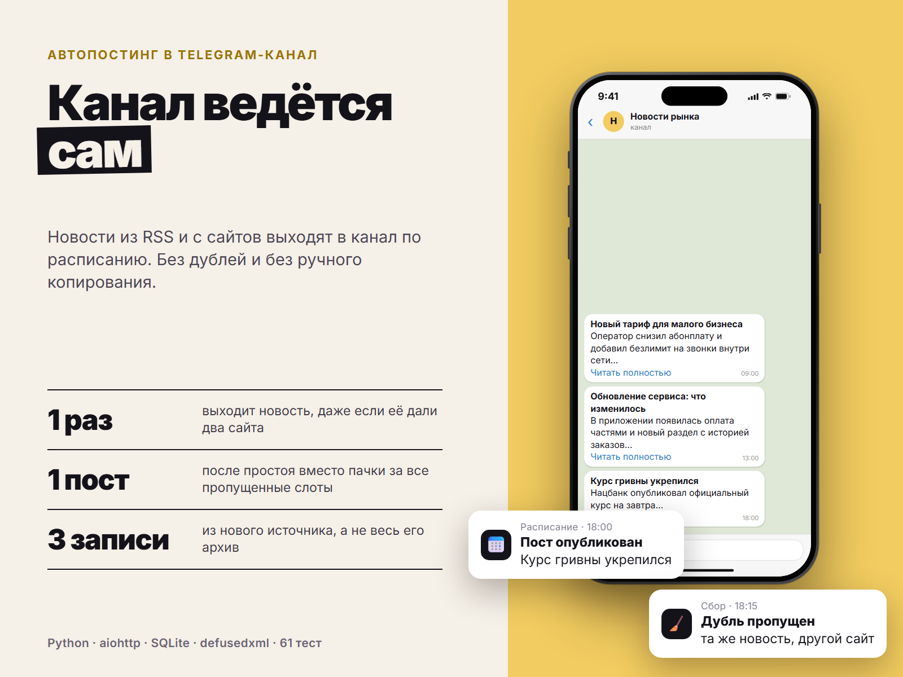

# Channel Autoposter

Автопостинг в Telegram-канал из RSS-лент и обычных сайтов. Сервис сам забирает новые материалы, выкидывает дубли и публикует их по расписанию: например, в 9:00, 13:00 и 18:00 по одному посту.



## Возможности

- Источники: RSS 2.0, Atom и сайты без RSS (берутся ссылки со страницы, адрес которых подходит под шаблон)
- **Защита от дублей в два слоя:**
  - по ссылке: `?utm_source=...`, `#якорь`, `www.`, `http/https` и слеш в конце не делают статью новой; ссылка, которая уже была, не публикуется никогда
  - по заголовку: та же новость с другого сайта или под новым адресом не выйдет второй раз в течение 3 дней. Ежедневные рубрики вроде «Курс валют на сегодня» продолжают выходить
- Новый источник не заваливает канал архивом: берутся только 3 последних материала (настраивается)
- Расписание: время публикаций, дни недели, сколько постов за раз. Если сервис был выключен и пропустил несколько слотов, после включения выйдет одна публикация, а не пачка
- Публикации идут от старых к новым
- Пост: жирный заголовок, короткое описание (HTML из ленты очищается, текст обрезается по границе слова), ссылка «Читать полностью», подпись канала
- Ошибки: упавший сайт не мешает остальным; если Telegram недоступен, пост остаётся в очереди до следующего слота; пост, который Telegram отклонил, пропускается и не блокирует очередь; при лимите (429) сервис ждёт столько, сколько попросил Telegram
- Всё хранится в SQLite: после перезапуска ничего не публикуется повторно
- Ленты разбираются через `defusedxml`: XML-подвохи с чужого сайта (XXE, «billion laughs») не проходят

## Как это устроено

```
autoposter/
  core.py      ключи дублей, текст поста, расписание (чистая логика)
  parsing.py   RSS/Atom и ссылки со страницы
  storage.py   SQLite: что видели, очередь, что опубликовано
  service.py   сбор → дубли → очередь → публикация по слотам
  adapters.py  скачивание сайтов и отправка в Bot API (aiohttp)
  config.py    .env и sources.json
  main.py      запуск
tests/         61 тест
```

Ядро и сервис не ходят в сеть: в тестах сайты и Telegram заменены заглушками, а сетевой слой проверяется на локальном aiohttp-сервере, который изображает и новостной сайт, и Bot API.

## Быстрый старт

1. Создайте бота у @BotFather и добавьте его в канал **администратором** с правом публиковать сообщения.
2. Установка:

```bash
python -m venv .venv
source .venv/bin/activate        # Windows: .venv\Scripts\activate
pip install -r requirements.txt
cp .env.example .env             # BOT_TOKEN, CHANNEL_ID, расписание
cp sources.example.json sources.json
```

3. В `sources.json` перечислите источники:

```json
{
  "sources": [
    {"name": "blog-rss", "url": "https://example.com/feed.xml"},
    {"name": "news-page", "url": "https://example.com/news/", "type": "html",
     "link_pattern": "example\\.com/news/\\d{4}/"}
  ]
}
```

Для `type: html` в `link_pattern` пишется регулярное выражение, под которое подходят адреса статей (а не меню и рубрик).

4. Проверка без публикации: `python -m autoposter.main --dry-run` скачает источники и покажет, как будут выглядеть посты. В канал ничего не отправляется.
5. Запуск: `python -m autoposter.main`.

## Тесты

```bash
pip install -r requirements-dev.txt
python -m pytest
```

## Лицензия

MIT
